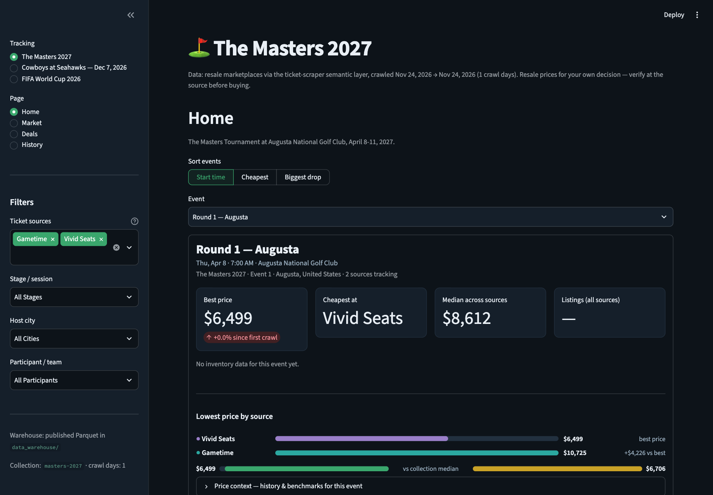

# ticket-scraper

**[Open the live dashboard](https://ticket-scraper-dashboard-acwhbjgnk3u4opik4qsm8z.streamlit.app/)**

[](https://github.com/holmbergf/ticket-scraper/actions/workflows/data-integration.yml) [](https://github.com/holmbergf/ticket-scraper/actions/workflows/dbt.yml) [](https://github.com/holmbergf/ticket-scraper/actions/workflows/dashboard.yml)



Generic ELT pipeline for resale ticket prices. A tracked tournament,
single game, or multi-session event is a **collection** declared in
[`collections/`](collections/); adding one TOML file (plus a thin
workflow caller) stands up its crawl, warehouse rows, and dashboard
pages without code changes. Three collections ship today: the FIFA
World Cup 2026 (104 matches), Cowboys at Seahawks, Dec 7 2026 (one
game), and the Masters 2027 (four tournament rounds).

The pipeline lands partitioned Parquet **in this repository**, models it
with dbt, and serves a Streamlit dashboard from the published semantic
layer. The dashboard flips between collections, each with the same
Home / Market / Deals / History views. Full design:
[docs/architecture.md](docs/architecture.md).

Ingestion runs on demand per collection (GitHub Actions
`workflow_dispatch` or locally); there are no schedules.

## Architecture

```text
Vivid Seats ─┐
Gametime ────┤
StubHub ─────┤  ticket-ingest ─► data/raw/<dataset>/…  partitioned Parquet
Viagogo ─────┤    (Python)       data/_manifests/…     run state (no DB)
FIFA Collect ┘                          │
                       dbt (DuckDB) ────┤ bronze views (1:1 casts)
                                        ├─ silver: clean staging, dim, facts
                                        ├─ gold: analytics marts
                                        └─ semantic: dollars, dashboard surface
                                               │
                       publish_warehouse ─► data/data_warehouse/{silver,gold,semantic}/*.parquet
                                               │
                       Streamlit dashboard (reads published Parquet only)
```

- **Collections** ([`collections/`](collections/)): one TOML per tracked
  collection — canonical events (optional), per-source discovery or
  direct event URLs, expected counts, and fetch priorities. See
  [`collections/README.md`](collections/README.md).
- **Ingestion** ([`data-integration/`](data-integration/)): marketplace
  adapters composed with a collection's source settings at crawl time.
  Rows are stamped with `collection_slug` + canonical `event_key` and
  aligned to frozen PyArrow schemas. Writes are content-addressed
  (`part-<hash>.parquet`) — re-runs write zero new files. State lives in
  `data/_manifests/`.
- **Warehouse** ([`dbt-transform/`](dbt-transform/)): bronze 1:1 casts,
  silver normalization + conformed event dim keyed by
  `(collection_slug, event_key)`, gold per-collection benchmarks, and a
  semantic layer in dollars. Publishing also emits collection/event
  catalogs behind the dashboard collection switcher.
- **Dashboard** ([`dashboard/`](dashboard/)): Streamlit app over the
  semantic exports — pick a tracked collection in the sidebar, then use
  its Home, Market, Deals, and History pages. Exports standalone via
  `dashboard/export_standalone.sh`.

## Repository structure

```text
ticket-scraper/
├── collections/            # One TOML per tracked collection + guide
├── data-integration/       # Ingestion package (ticket-ingest CLI)
│   ├── src/ticket_ingest/  # parsers, http, collections, schemas, storage, jobs
│   ├── tests/              # pytest (committed HTML fixtures, offline)
│   └── Dockerfile          # Stateless runner image
├── dbt-transform/          # dbt warehouse (DuckDB)
│   ├── models/connector/tickets/{bronze,silver,gold,semantic}/
│   ├── seeds/              # team/city/stage/country mappings
│   └── tests/fixtures/     # mock raw samples for CI
├── dashboard/              # Streamlit app + tests
├── data/                   # THE STORAGE LAYER (committed)
│   ├── raw/                # partitioned Parquet, append-only
│   ├── _manifests/         # run manifests (pipeline state)
│   └── data_warehouse/     # published serving exports
└── .github/workflows/      # reusable ingest + per-collection callers + CI
```

## Operation

| Workflow | Trigger | What it does |
|---|---|---|
| `ingest/fifa-world-cup-2026` | Manual | Crawl that collection (optional single source) |
| `ingest/nfl-cowboys-at-seahawks-2026-12-07` | Manual | Crawl that collection |
| `ingest/masters-2027` | Manual | Crawl that collection |
| `ingest (reusable)` | Called by the above / manual | crawl → `dbt build --target prod` → publish → commit `data/`; alert + failure issues |
| `ci/data-integration` | `data-integration/**`, `collections/**` | pytest, byte-compile, CLI smoke |
| `ci/dbt` | Changes under `dbt-transform/**` | Full dbt build + data tests on mock fixtures; slim selection vs prod manifest reported informationally |
| `ci/dashboard` | Changes under `dashboard/**` | pytest data layer, byte-compile |

CI workflows are path-filtered and independent. Ingestion is manual
per collection; there are no schedules.

## Local development

Prerequisites: Python 3.11+, Google Chrome (Vivid Seats browser fallback).

```bash
python3 -m venv .venv && source .venv/bin/activate
pip install -e "./data-integration[dev]" dbt-duckdb duckdb
pip install -r dashboard/requirements.txt
playwright install chrome chromium
cp .env.example .env   # optional path overrides only; no secrets exist
```

```bash
# Collections
ticket-ingest collections list
ticket-ingest collections validate nfl-cowboys-at-seahawks-2026-12-07

# Crawl one collection (all its sources, or one)
ticket-ingest crawl --collection fifa-world-cup-2026
ticket-ingest crawl --collection nfl-cowboys-at-seahawks-2026-12-07 --source gametime

# Warehouse
cd dbt-transform && dbt build --target prod --profiles-dir . && cd ..
python -m ticket_ingest.publish_warehouse

# Import a SQLite DB (events/market_snapshots/listings) into the raw zone
ticket-ingest migrate-sqlite path/to/tickets.db

# Tests
python -m pytest data-integration/tests dashboard/tests -q
cd dbt-transform && RAW_BASE_PATH=tests/fixtures dbt build --profiles-dir .

# Dashboard
streamlit run dashboard/streamlit_app.py
```

Use the library directly:

```python
from pathlib import Path
from ticket_ingest.storage import LocalStorage, StateStore

state = StateStore(LocalStorage(Path("data")))
print(state.crawl_timestamps()[-1],
      len(state.event_ids_for_source("stubhub", "fifa-world-cup-2026")))
```

## Configuration

Paths only (see [`.env.example`](.env.example)): `DATA_DIR`,
`RAW_HTML_DIR`, `COLLECTIONS_DIR`, `RAW_BASE_PATH`, `WAREHOUSE_DIR` —
identical names locally and in GitHub Actions. Ingest workflows commit
with the default `GITHUB_TOKEN`.

## Data notes

- Canonical identity is `(collection_slug, event_key)` everywhere;
  `event_uid` is the global form. FIFA rows written before collections
  derive `match-<n>` keys in dbt silver, so no raw rewrite was needed.
- FIFA history covers 2026-04-04 → 2026-05-04 (154 crawls): 481 source
  events over 104 matches, 35,484 canonical market snapshots, 591,953
  listings. The Cowboys and Masters collections add live observations
  from their first crawls in November 2026.
- One canonical snapshot per (collection, source, event, crawl): where a
  crawl produces discovery-page and event-page rows under one timestamp,
  the event-page row is kept (latest insert wins).
- Prices are integer cents until the semantic layer. Raw schemas are
  frozen contracts in `ticket_ingest/schemas.py`.

## License and data

Code is MIT-licensed (see [`LICENSE`](LICENSE)). Committed Parquet files
are factual resale-price observations collected from public marketplace
pages; see [`DATA.md`](DATA.md) for provenance, limitations, and reuse
terms. This project is not affiliated with FIFA, the NFL, Augusta
National, or any marketplace.
