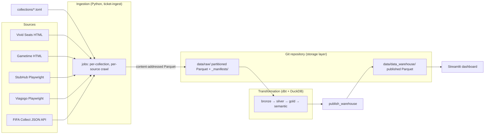
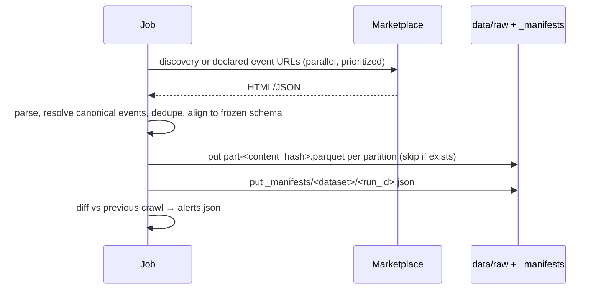

# Architecture

End-to-end architecture of ticket-scraper: how resale ticket prices for
any tracked collection — a tournament, a single game, or a multi-session
event — move from marketplaces to a collection-scoped dashboard. The git repository is the storage layer. For a quick
start see the [README](../README.md); for adding a collection see
[`collections/README.md`](../collections/README.md).

## 1. Overview and design principles

Design principles:

- **Collections are configuration.** A new tracked tournament/game/event
  is a TOML file plus a thin workflow caller — never new pipeline code.
  Canonical identity is `(collection_slug, event_key)` everywhere.
- **ELT, not ETL.** Sources land close to native shape ("raw"); all
  shaping happens in dbt. A transformation bug never requires re-scraping.
- **Idempotency everywhere.** Every write is content-addressed or a full
  overwrite of a derived table. Re-running any job converges to the same
  state and writes zero new files when nothing changed.
- **State in the storage layer, not a database.** Watermarks/coverage
  derive from run manifests committed next to the data.
- **Derived data is disposable.** Everything downstream of `data/raw/`
  rebuilds from it in seconds. Raw is the only irreplaceable layer.
- **Manual ingestion.** Crawls run on demand per collection; no schedules.

## 2. Storage shape

Data is stored as partitioned, append-only, content-addressed Parquet in
the repo. Measured on the committed history (35k snapshots, 592k
listings): 4.3 MB across 67 partition files, ~125 KB of new files per
crawl, largest single file < 1 MB. Commits only add the current crawl's
files; no existing file is rewritten or grows.

Two guardrails:

1. **Derived history-scale tables are not committed.** `publish_warehouse`
   exports all 15 models locally / as CI artifacts, but git only tracks
   the bounded serving set (`semantic/*`, `gold/*`,
   `silver/fct_tickets_listings_latest.parquet` ≈ 425 KB). The silver
   history mirrors are gitignored and rebuildable from raw.
2. **Deterministic publishes.** Exports are written `ORDER BY ALL`, so a
   rebuild over unchanged raw data is byte-identical and a no-op ingest
   produces an empty commit.

## 3. Sources and collection modes

Marketplace adapters are fixed; collections choose how each source is
driven:

| Mode | Behavior |
|---|---|
| `discovery` | Fetch a performer/category page, keep events that resolve to declared canonical events (or derive keys when none are declared), then fetch their event pages |
| `event_urls` | Fetch declared event pages directly — the reliable path for one-off games |
| `cross_source` | Build event URLs from another source's ids via `event_url_template` (Viagogo from StubHub) |

| Source | Access notes |
|---|---|
| Vivid Seats | Headless Chrome (`--dump-dom`) |
| Gametime | HTTP for static pages; Playwright + `event_wait_selector` where listings render client-side |
| StubHub | Playwright on installed Chrome; cold deep links hit a DataDome CAPTCHA wall, so sessions warm via home/performer pages first; optional sub-page expansion |
| Viagogo | Playwright on installed Chrome; often cross-built from StubHub ids |
| FIFA Collect | JSON API (`collect.fifa.com` RTT marketplace); FIFA collection only |

Rate-limit rule: repeated crawls more often than ~60 s can trigger
StubHub/Viagogo WAF IP blocks. Verified block anatomy (Cowboys test):
DataDome (`x-datadome: protected`, `rt='c'`) 403s Playwright's bundled
Chromium even warm, and installed Chrome on a cold deep link; installed
Chrome + a warmed home→performer session returns 200. Forcing static
`Sec-Fetch-*` headers also retriggers the wall, so contexts let Chrome
set them. If a network still gets a CAPTCHA wall, the supported routes
are the official StubHub/Viagogo affiliate APIs (OAuth keys on request)
or running that collection locally — not CAPTCHA solving.

## 4. Ingestion (`data-integration/`)

Python package `ticket_ingest`, CLI
`ticket-ingest {crawl --collection, collections list|validate, migrate-sqlite}`.

| Module | Responsibility |
|---|---|
| `config.py` | `Settings` from env (paths only) |
| `collections.py` | TOML collection loading/validation + canonical-event resolution |
| `parsers/` | Per-marketplace discovery + event parsing (raw, unnormalized) |
| `http.py` | urllib3 pool, Chrome, Playwright (throttle, cookies, retries, wait selectors) |
| `models.py` | `Event` / `MarketSnapshot` / `Listing` / `ParseResult`, all carrying collection identity |
| `schemas.py` | **Frozen PyArrow raw schemas** — the ingestion↔bronze contract |
| `clean.py` | Content hash, natural-key dedupe |
| `storage.py` | Partitioned Parquet writes, manifests, `StateStore` |
| `jobs.py` | Adapter × collection composition; per-source orchestration |
| `alerts.py` | Per-collection snapshot diffs + alert rules over raw (DuckDB) |
| `publish_warehouse.py` | DuckDB → `data_warehouse/` Parquet exports + collection/event catalogs |
| `migrate.py` | SQLite → Parquet raw-zone import (idempotent) |

Write path per source crawl:

### Idempotency, state, and canonical snapshots

- **Content-addressed partitions.** Keys embed a hash of partition content
  excluding `timestamp_imported`:
  `raw/<dataset>/<partition>/part-<hash>.parquet` (events by `source=`,
  snapshots/listings by `crawl_date=`). Identical re-fetches map to the
  same key and are skipped.
- **Manifest-derived state.** Each write records covered crawl timestamps,
  sources, and row counts. `StateStore` reconstructs crawl history and
  known event ids (Viagogo cross-source fallback) from manifests + raw.
- **One canonical snapshot per (source, event, crawl).** A crawl can
  produce both discovery-page and event-page snapshots under one
  `crawl_ts`; ingestion dedupes to the event-page row ("latest insert
  wins") at land time.
- **Raw HTML snapshots are not committed.** They live under gitignored
  `data/raw_html/` for debugging.

## 5. Transformation: dbt on DuckDB (`dbt-transform/`)

DuckDB reads the raw zone directly
(`read_parquet(..., hive_partitioning=true)` via the `raw_table` macro,
`RAW_BASE_PATH` selecting repo data vs CI fixtures) and builds into a
local `.duckdb` file. There is no warehouse server.

| Layer | Models | Contract |
|---|---|---|
| bronze (views) | `stg_tickets_events`, `stg_tickets_market_snapshots`, `stg_tickets_listings` | 1:1 casts of the frozen schemas; a raw break fails here |
| silver staging | `clean_tickets_events` (normalize + collapse), `clean_tickets_market_snapshots`, `clean_tickets_listings` (bogus-row filter) | All source ugliness resolved here; mappings are seeds |
| silver core | `dim_tickets_events` (1 row/canonical event), `fct_tickets_market_snapshots`, `fct_tickets_latest_prices`, `fct_tickets_listings_latest` | Integer cents; `(collection_slug, event_key)` is the conformed cross-source key |
| gold | `analytics_tickets_market_benchmarks`, `…_source_overviews`, `…_price_changes` | Per-collection pre-aggregated marts, still cents |
| semantic (views) | `semantic_event_prices`, `semantic_source_prices`, `semantic_price_trends`, `semantic_market_trends`, `semantic_source_overview` | **Only layer in dollars**; the dashboard's surface |

Tests as contracts: schema tests on grains/keys plus
singular SQL tests named for the failure they prevent —
`clean_events_grain` (raw versions must collapse or facts fan out),
`snapshots_have_events` (join coverage; unmatched snapshots would vanish
silently), `prices_positive` (parsers store null, never 0),
`semantic_dollars_match_cents`, `event_prices_best_is_min`,
`latest_prices_grain`, `dim_display_names_unique`. CI runs the full build
against committed mock raw fixtures (pre-collection schema generation,
so backward compatibility is tested) with no credentials.

Full-refresh throughout; exit to incremental merge on
`(collection_slug, source, event_id_external, crawl_ts_utc)` when a build
nears ~10 min (it takes seconds on the full committed history).

Metric definitions:

- **Daily best price** (benchmarks, price changes) is the minimum over
  canonical per-crawl snapshots for the day. Discovery-page featured
  prices are never used — only event-page snapshots are canonical.
- **Country is canonicalized** in silver (`US`/`USA`/`United States of
  America` → `United States`) via seed.
- **Medians** are DuckDB's exact `MEDIAN`.

## 6. Publishing

`python -m ticket_ingest.publish_warehouse [warehouse.duckdb]` exports the
registered models to `data/data_warehouse/<layer>/<table>.parquet`
(zstd, `ORDER BY ALL`, all-null columns cast to string for a stable
schema), then builds `semantic_collections` and `semantic_event_catalog`
from the collection TOML files merged with the warehouse dimension — so
a configured collection/event exists in the serving layer even before
its first crawl. The Parquet export is the serving contract.

## 7. Dashboard (`dashboard/`)

Streamlit app reading only published exports via `dashboard/warehouse.py`
(DuckDB over Parquet; `WAREHOUSE_DIR` / bundled layout / repo layout).
The sidebar selects the tracked collection first; the four pages
(Home, Market, Deals, History) then render that collection. Within a
collection, canonical events are selected on Home/History rather than
given separate navigation pages. Source-subset views
recompute at read time. The exports are committed, so the app needs no
credentials. For Streamlit Community Cloud, `export_standalone.sh`
bundles the app + the serving Parquet snapshot into a standalone repo
(`fholmberg/ticket-scraper-dashboard`).

## 8. Orchestration and CI

One reusable ingest workflow, a thin manual caller per collection, and
three path-filtered CI workflows:

| Workflow | Trigger | Gate / job |
|---|---|---|
| `ingest-<slug>` (per collection) | Manual | Calls the reusable workflow with its collection slug |
| `ingest (reusable)` | `workflow_call` / manual | validate collection → crawl (shell `retry` ×3) → dbt build prod → publish → commit data zones → alert/failure issues |
| `ci/data-integration` | `data-integration/**`, `collections/**` | pytest, byte-compile, CLI smoke |
| `ci/dbt` | `dbt-transform/**` | Full dbt build + data tests on mock fixtures; slim selection vs prod manifest reported informationally |
| `ci/dashboard` | `dashboard/**` | pytest data layer, byte-compile |

A per-collection concurrency group serializes each collection's runs.
Ingestion is manual; there are no schedules.

## 9. Technology choices

| Concern | Choice | Notes |
|---|---|---|
| Storage | Git repo (partitioned Parquet) | ~125 KB per crawl (see §2) |
| Landing format | Parquet (zstd), hive partitions | Columnar, self-describing, content-addressable; DuckDB reads it natively |
| Ingestion | Python (`ticket-ingest`) | Parsers/fetch for the five marketplaces |
| Transformation | dbt (SQL) on DuckDB | Declared graph, tests as contracts; embedded, no server |
| Orchestration | GitHub Actions reusable workflow + per-collection callers | Also the committer of the storage layer |
| Collection config | TOML in `collections/` | Stdlib-parsed; drives crawl, publish catalogs, and dashboard pages |
| BI | Streamlit over published Parquet | Reads the semantic serving exports |
