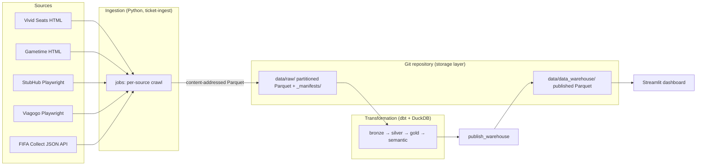
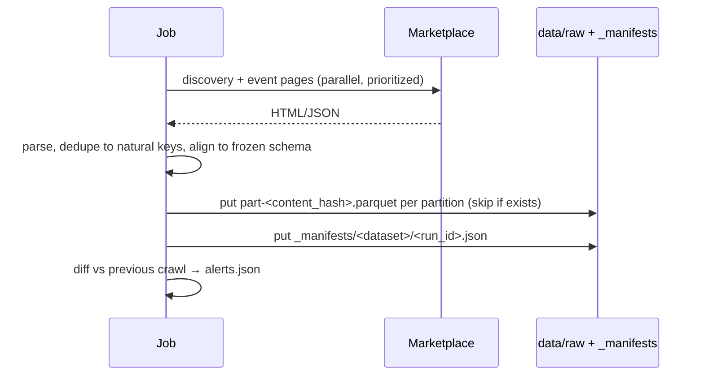

# Architecture

End-to-end architecture of ticket-scraper: how FIFA World Cup 2026 resale
ticket prices move from five marketplaces to a dashboard. The git
repository is the storage layer. For a quick start see the
[README](../README.md).

## 1. Overview and design principles

Design principles:

- **ELT, not ETL.** Sources land close to native shape ("raw"); all
  shaping happens in dbt. A transformation bug never requires re-scraping.
- **Idempotency everywhere.** Every write is content-addressed or a full
  overwrite of a derived table. Re-running any job converges to the same
  state and writes zero new files when nothing changed.
- **State in the storage layer, not a database.** Watermarks/coverage
  derive from run manifests committed next to the data.
- **Derived data is disposable.** Everything downstream of `data/raw/`
  rebuilds from it in seconds. Raw is the only irreplaceable layer.
- **Manual ingestion.** Crawls run on demand; there is no schedule.

## 2. Storage shape

Data is stored as partitioned, append-only, content-addressed Parquet in
the repo. Measured on the committed history (35k snapshots, 592k
listings): 4.3 MB across 67 partition files, ~125 KB of new files per
crawl, largest single file < 1 MB. Commits only add the current crawl's
files; no existing file is rewritten or grows.

Two guardrails:

1. **Derived history-scale tables are not committed.** `publish_warehouse`
   exports all 15 models locally / as CI artifacts, but git only tracks
   the bounded serving set (`semantic/*`, `gold/*`,
   `silver/fct_tickets_listings_latest.parquet` ≈ 425 KB). The silver
   history mirrors are gitignored and rebuildable from raw.
2. **Deterministic publishes.** Exports are written `ORDER BY ALL`, so a
   rebuild over unchanged raw data is byte-identical and a no-op ingest
   produces an empty commit.

## 3. Sources

| Source | Access | Coverage |
|---|---|---|
| Vivid Seats | Headless Chrome (`--dump-dom`) | ~91 matches |
| Gametime | Plain HTTP | 104 matches |
| StubHub | Playwright (AWS WAF needs full JS); city sub-pages sequential @ 10 s gaps + 45 s challenge backoff | ~91 matches |
| Viagogo | Playwright, event URLs cross-built from StubHub ids | ~91 matches |
| FIFA Collect | JSON API (`collect.fifa.com` RTT marketplace) | 104 matches |

Rate-limit rule: repeated crawls more often than ~60 s can trigger
StubHub/Viagogo WAF IP blocks.

## 4. Ingestion (`data-integration/`)

Python package `ticket_ingest`, CLI `ticket-ingest {crawl,migrate-sqlite}`.

| Module | Responsibility |
|---|---|
| `config.py` | `Settings` from env (paths only) |
| `parsers/` | Per-marketplace discovery + event parsing (raw, unnormalized) |
| `http.py` | urllib3 pool, Chrome, Playwright (per-domain throttle, cookie persistence, retries) |
| `models.py` | `Event` / `MarketSnapshot` / `Listing` / `ParseResult` |
| `schemas.py` | **Frozen PyArrow raw schemas** — the ingestion↔bronze contract |
| `clean.py` | Content hash, natural-key dedupe |
| `storage.py` | Partitioned Parquet writes, manifests, `StateStore` |
| `jobs.py` | Per-source orchestration (parallel sources; Viagogo after StubHub) |
| `alerts.py` | Snapshot diffs + alert rules over raw (DuckDB) |
| `publish_warehouse.py` | DuckDB → `data_warehouse/` Parquet exports |
| `migrate.py` | SQLite → Parquet raw-zone import (idempotent) |

Write path per source crawl:

### Idempotency, state, and canonical snapshots

- **Content-addressed partitions.** Keys embed a hash of partition content
  excluding `timestamp_imported`:
  `raw/<dataset>/<partition>/part-<hash>.parquet` (events by `source=`,
  snapshots/listings by `crawl_date=`). Identical re-fetches map to the
  same key and are skipped.
- **Manifest-derived state.** Each write records covered crawl timestamps,
  sources, and row counts. `StateStore` reconstructs crawl history and
  known event ids (Viagogo cross-source fallback) from manifests + raw.
- **One canonical snapshot per (source, event, crawl).** A crawl can
  produce both discovery-page and event-page snapshots under one
  `crawl_ts`; ingestion dedupes to the event-page row ("latest insert
  wins") at land time.
- **Raw HTML snapshots are not committed.** They live under gitignored
  `data/raw_html/` for debugging.

## 5. Transformation: dbt on DuckDB (`dbt-transform/`)

DuckDB reads the raw zone directly
(`read_parquet(..., hive_partitioning=true)` via the `raw_table` macro,
`RAW_BASE_PATH` selecting repo data vs CI fixtures) and builds into a
local `.duckdb` file. There is no warehouse server.

| Layer | Models | Contract |
|---|---|---|
| bronze (views) | `stg_tickets_events`, `stg_tickets_market_snapshots`, `stg_tickets_listings` | 1:1 casts of the frozen schemas; a raw break fails here |
| silver staging | `clean_tickets_events` (normalize + collapse), `clean_tickets_market_snapshots`, `clean_tickets_listings` (bogus-row filter) | All source ugliness resolved here; mappings are seeds |
| silver core | `dim_tickets_matches` (1 row/match), `fct_tickets_market_snapshots`, `fct_tickets_latest_prices`, `fct_tickets_listings_latest` | Integer cents; `match_number` is the conformed cross-source key (100% populated, 104 matches) |
| gold | `analytics_tickets_market_benchmarks`, `…_source_overviews`, `…_price_changes` | Pre-aggregated marts, still cents |
| semantic (views) | `semantic_match_prices`, `semantic_source_prices`, `semantic_price_trends`, `semantic_market_trends`, `semantic_source_overview` | **Only layer in dollars**; the dashboard's surface |

Tests as contracts: schema tests on grains/keys plus
singular SQL tests named for the failure they prevent —
`clean_events_grain` (raw versions must collapse or facts fan out),
`snapshots_have_events` (join coverage; unmatched snapshots would vanish
silently), `prices_positive` (parsers store null, never 0),
`semantic_dollars_match_cents`, `match_prices_best_is_min`,
`latest_prices_grain`. CI runs the full build against committed mock raw
fixtures (matches 1/2/4, three crawl dates) with no credentials.

Full-refresh throughout; exit to incremental merge on
`(source, event_id_external, crawl_ts_utc)` when a build nears ~10 min
(it takes ~2 s on the full committed history).

Metric definitions:

- **Daily best price** (benchmarks, price changes) is the minimum over
  canonical per-crawl snapshots for the day. Discovery-page featured
  prices are never used — only event-page snapshots are canonical.
- **Country is canonicalized** in silver (`US`/`USA`/`United States of
  America` → `United States`) via seed.
- **Medians** are DuckDB's exact `MEDIAN`.

## 6. Publishing

`python -m ticket_ingest.publish_warehouse [warehouse.duckdb]` exports the
15 registered models to `data/data_warehouse/<layer>/<table>.parquet`
(zstd, `ORDER BY ALL`, all-null columns cast to string for a stable
schema). The Parquet export is the serving contract — for the dashboard
and any other file reader.

## 7. Dashboard (`dashboard/`)

Streamlit app reading only published exports via `dashboard/data.py`
(DuckDB over Parquet; `WAREHOUSE_DIR` / bundled layout / repo layout).
Source-subset views are recomputed at read time from the published
semantic tables. The exports it needs are committed to this repo, so the
app needs no credentials. For Streamlit Community Cloud,
`export_standalone.sh` bundles the app + the serving Parquet snapshot
into a standalone repo.

## 8. Orchestration and CI

One manual ingest workflow + three path-filtered CI workflows (a change
to one module never runs another's CI):

| Workflow | Trigger | Gate / job |
|---|---|---|
| `ingest` | Manual (`workflow_dispatch`, optional single source) | crawl (shell `retry` ×3 — safe, writes are content-addressed) → dbt build prod → publish → commit data zones → alert/failure GitHub issues; uploads warehouse + dbt manifest artifacts |
| `ci/data-integration` | `data-integration/**` | pytest (committed HTML fixtures), byte-compile, CLI smoke |
| `ci/dbt` | `dbt-transform/**` | Full dbt build + data tests on mock fixtures; slim selection vs prod manifest reported informationally |
| `ci/dashboard` | `dashboard/**` | pytest data layer, byte-compile |

A concurrency group serializes ingest runs. Ingestion has no schedule:
the tournament has concluded, so crawls run on demand only.

## 9. Technology choices

| Concern | Choice | Notes |
|---|---|---|
| Storage | Git repo (partitioned Parquet) | ~125 KB per crawl (see §2) |
| Landing format | Parquet (zstd), hive partitions | Columnar, self-describing, content-addressable; DuckDB reads it natively |
| Ingestion | Python (`ticket-ingest`) | Parsers/fetch for the five marketplaces |
| Transformation | dbt (SQL) on DuckDB | Declared graph, tests as contracts; embedded, no server |
| Orchestration | GitHub Actions (manual dispatch) | Also the committer of the storage layer |
| BI | Streamlit over published Parquet | Reads the semantic serving exports |
