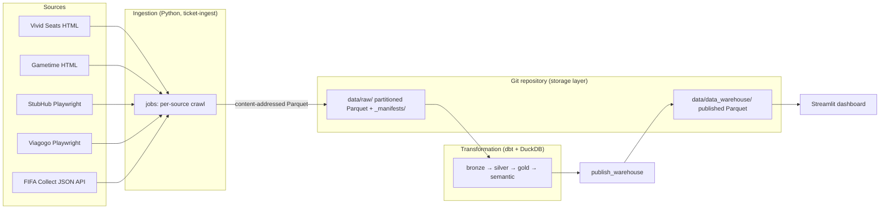
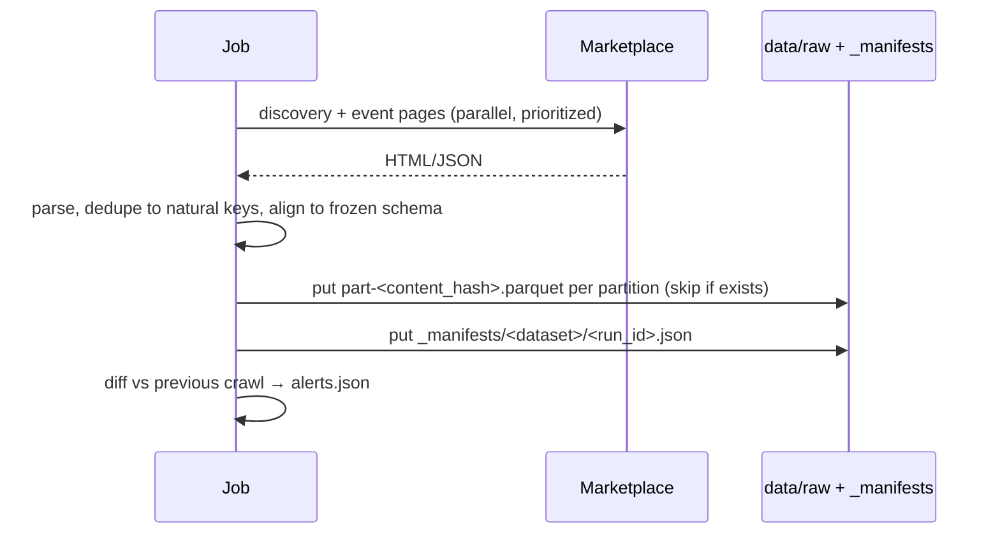

# Architecture

End-to-end architecture of ticket-scraper: how FIFA World Cup 2026 resale
ticket prices move from five marketplaces to a dashboard, and why the
pipeline is built the way it is. This repo is a fork of
`fholmberg/fifa_tickets` restructured on the conventions established in
`holmbergf/elt-pipeline`, with one deliberate substitution: **the git
repository replaces Cloudflare R2 + Basin Catalog as the storage layer.**
For a quick start see the [README](../README.md).

## 1. Overview and design principles

Design principles (inherited from elt-pipeline):

- **ELT, not ETL.** Sources land close to native shape ("raw"); all
  shaping happens in dbt. A transformation bug never requires re-scraping.
- **Idempotency everywhere.** Every write is content-addressed or a full
  overwrite of a derived table. Re-running any job converges to the same
  state and writes zero new files when nothing changed.
- **State in the storage layer, not a database.** Watermarks/coverage
  derive from run manifests committed next to the data.
- **Derived data is disposable.** Everything downstream of `data/raw/`
  rebuilds from it in seconds. Raw is the only irreplaceable layer.
- **No infrastructure.** elt-pipeline provisions R2/Basin with Terraform;
  here there is nothing to provision — GitHub (repo + Actions) is the
  entire platform. The `infra/` module is dropped, not ported.

## 2. Why the old design hit GitHub's storage limits — and why this one doesn't

The legacy design committed one monolithic SQLite file
(`data/test_full3.db`) after every crawl. Measured at fork time:

| | Legacy SQLite-in-git | This design (Parquet) |
|---|---|---|
| Full 31-day history | 103.3 MB single file | 4.3 MB across 67 partition files |
| Per-crawl commit | whole DB rewritten (65–103 MB blob per commit) | ~125 KB of *new* partition files only |
| GitHub per-file limit (100 MB) | **exceeded** — pushes rejected, scheduled workflow disabled in `ac436c3` | largest file < 1 MB |
| History growth at 3 crawls/day | ~65–100 MB × 3/day (delta-compressed, still fatal) | ~11 MB/month of append-only data |
| Repository size at fork | 35 MB (`diskUsage`), `.git` 50 MB after 98 commits | starts at ~9 MB incl. full migrated history |

The data itself was never big — 52k snapshots + 592k listings compress to
~4 MB of zstd Parquet. The failure was purely the storage *shape*:
rewriting a growing binary monolith in every commit. Partitioned,
append-only, content-addressed Parquet inverts both properties: commits
only add the current crawl's files, and no file ever grows.

Two guardrails keep it that way:

1. **Derived history-scale tables are not committed.** `publish_warehouse`
   exports all 15 models locally/ as CI artifacts, but git only tracks the
   bounded serving set (`semantic/*`, `gold/*`,
   `silver/fct_tickets_listings_latest.parquet` ≈ 425 KB). The silver
   history mirrors are gitignored and rebuildable.
2. **Deterministic publishes.** Exports are written `ORDER BY ALL`, so a
   rebuild over unchanged raw data is byte-identical — a no-op ingest
   produces an empty commit, verified by checksum in development.

Exit condition, stated now: if the committed serving set or raw zone ever
makes the repo unwieldy (rule of thumb: >500 MB), partition
`semantic_price_trends` by `crawl_date` like the raw zone, or move the
serving exports out of git entirely. At measured growth that is years away.

## 3. Sources

Identical to the legacy crawler (parsers and fetch logic ported verbatim):

| Source | Access | Coverage |
|---|---|---|
| Vivid Seats | Headless Chrome (`--dump-dom`) | ~91 matches |
| Gametime | Plain HTTP | 104 matches |
| StubHub | Playwright (AWS WAF needs full JS); city sub-pages sequential @ 10 s gaps + 45 s challenge backoff | ~91 matches |
| Viagogo | Playwright, event URLs cross-built from StubHub ids | ~91 matches |
| FIFA Collect | JSON API (`collect.fifa.com` RTT marketplace) | 104 matches |

Rate-limit rule carried over: repeated crawls more often than ~60 s can
trigger StubHub/Viagogo WAF IP blocks — irrelevant at scheduled cadence.

## 4. Ingestion (`data-integration/`)

Python package `ticket_ingest`, CLI `ticket-ingest {crawl,migrate-sqlite}`.

| Module | Responsibility |
|---|---|
| `config.py` | `Settings` from env (paths only — no cloud backend, no secrets) |
| `parsers/` | Per-marketplace discovery + event parsing (raw, unnormalized) |
| `http.py` | urllib3 pool, Chrome, Playwright (per-domain throttle, cookie persistence, retries) |
| `models.py` | `Event` / `MarketSnapshot` / `Listing` / `ParseResult` |
| `schemas.py` | **Frozen PyArrow raw schemas** — the ingestion↔bronze contract |
| `clean.py` | Content hash, natural-key dedupe |
| `storage.py` | Partitioned Parquet writes, manifests, `StateStore` |
| `jobs.py` | Per-source orchestration (parallel sources; Viagogo after StubHub) |
| `alerts.py` | Snapshot diffs + alert rules over raw (DuckDB) |
| `publish_warehouse.py` | DuckDB → `data_warehouse/` Parquet exports |
| `migrate.py` | Legacy SQLite → Parquet history migration (idempotent) |

Write path per source crawl:

### Idempotency, state, and canonical snapshots

- **Content-addressed partitions.** Keys embed a hash of partition content
  excluding `timestamp_imported`:
  `raw/<dataset>/<partition>/part-<hash>.parquet` (events by `source=`,
  snapshots/listings by `crawl_date=`). Identical re-fetches map to the
  same key and are skipped.
- **Manifest-derived state.** Each write records covered crawl timestamps,
  sources, and row counts. `StateStore` reconstructs crawl history and
  known event ids (Viagogo cross-source fallback) from manifests + raw.
- **One canonical snapshot per (source, event, crawl).** The legacy
  crawler stored both discovery-page and event-page snapshots under one
  `crawl_ts`; every legacy reader resolved them with `MAX(id)` ("latest
  insert wins" = event page). Ingestion now dedupes to that winner at
  land time. Migration of the legacy DB reproduced the winners exactly
  (52,279 → 35,484 rows, 0 value mismatches vs `MAX(id)`).
- **Raw HTML snapshots are not committed.** They were never committed
  before either (only their paths were, pointlessly); they now live under
  gitignored `data/raw_html/` for debugging and `raw_snapshot_path` is
  dropped from the raw schema.

## 5. Transformation: dbt on DuckDB (`dbt-transform/`)

No warehouse server and no catalog: DuckDB reads the raw zone directly
(`read_parquet(..., hive_partitioning=true)` via the `raw_table` macro,
`RAW_BASE_PATH` selecting repo data vs CI fixtures) and builds into a
local `.duckdb` file. This replaces both Basin Catalog/Iceberg *and* the
legacy `analytics.py` (803 lines of Python aggregation, now SQL models).

| Layer | Models | Contract |
|---|---|---|
| bronze (views) | `stg_tickets_events`, `stg_tickets_market_snapshots`, `stg_tickets_listings` | 1:1 casts of the frozen schemas; a raw break fails here |
| silver staging | `clean_tickets_events` (normalize + collapse), `clean_tickets_market_snapshots`, `clean_tickets_listings` (bogus-row filter) | All source ugliness resolved here; mappings are seeds |
| silver core | `dim_tickets_matches` (1 row/match), `fct_tickets_market_snapshots`, `fct_tickets_latest_prices`, `fct_tickets_listings_latest` | Integer cents; `match_number` is the conformed cross-source key (100% populated, 104 matches) |
| gold | `analytics_tickets_market_benchmarks`, `…_source_overviews`, `…_price_changes` | Pre-aggregated marts, still cents |
| semantic (views) | `semantic_match_prices`, `semantic_source_prices`, `semantic_price_trends`, `semantic_market_trends`, `semantic_source_overview` | **Only layer in dollars**; the dashboard's surface |

Tests as contracts (elt-pipeline style): schema tests on grains/keys plus
singular SQL tests named for the failure they prevent —
`clean_events_grain` (raw versions must collapse or facts fan out),
`snapshots_have_events` (join coverage; unmatched snapshots would vanish
silently), `prices_positive` (parsers store null, never 0),
`semantic_dollars_match_cents`, `match_prices_best_is_min`,
`latest_prices_grain`. CI runs the full build against committed mock raw
fixtures (matches 1/2/4, three crawl dates) with no credentials.

Full-refresh throughout; exit to incremental merge on
`(source, event_id_external, crawl_ts_utc)` when a build nears ~10 min
(it takes ~2 s on the full migrated history).

### Deliberate corrections vs legacy analytics

- **Benchmarks/price-changes no longer see discovery teasers.** Legacy
  `get_market_benchmarks`/`get_price_changes` took `MIN(lowest)` over
  *all* snapshot rows, including StubHub grouping pages that repeat a
  featured price ($1,795) while the event page says $2,529 — while legacy
  latest-price surfaces used the event-page row. Gold models use the
  canonical per-crawl snapshot everywhere: 261 of 3,224 legacy game-days
  change value; all other surfaces match legacy exactly (validated:
  source overviews identical, best price per match 0/104 mismatches).
- **Country is canonicalized** (`US`/`USA`/`United States of America` →
  `United States`) via seed; legacy passed raw values through.
- **Median is exact** (DuckDB `MEDIAN`) vs legacy integer median (≤1¢).

## 6. Publishing

`python -m ticket_ingest.publish_warehouse [warehouse.duckdb]` exports the
15 registered models to `data/data_warehouse/<layer>/<table>.parquet`
(zstd, `ORDER BY ALL`, all-null columns cast to string for a stable
schema). Where elt-pipeline's publisher exists to work around DuckDB's
Iceberg `CREATE OR REPLACE` limitation, here the Parquet export simply
*is* the serving contract — for the dashboard and any other file reader.

## 7. Dashboard (`dashboard/`)

Streamlit app reading only published exports via `dashboard/data.py`
(DuckDB over Parquet; `WAREHOUSE_DIR` / bundled layout / repo layout).
Source-subset views are recomputed at read time from the published
semantic tables — the same read-time-semantics rule as elt-pipeline's
Upcoming page. No secrets: the exports it needs are committed to this
repo. For Streamlit Community Cloud (which can't deploy from this private
repo with a scoped grant), `export_standalone.sh` bundles the app + the
serving Parquet snapshot into a standalone repo.

## 8. Orchestration and CI

One autonomous workflow + three path-filtered CI workflows (a change to
one module never runs another's CI):

| Workflow | Trigger | Gate / job |
|---|---|---|
| `ingest` | 00:00/08:00/16:00 UTC daily + manual (optional single source) | crawl (shell `retry` ×3 — safe, writes are content-addressed) → dbt build prod → publish → commit data zones → alert/failure GitHub issues; uploads warehouse + dbt manifest artifacts |
| `ci/data-integration` | `data-integration/**` | pytest (committed HTML fixtures), byte-compile, CLI smoke |
| `ci/dbt` | `dbt-transform/**` | Full dbt build + data tests on mock fixtures; slim selection vs prod manifest reported informationally |
| `ci/dashboard` | `dashboard/**` | pytest data layer, byte-compile |

A concurrency group serializes ingest runs. GitHub cron is UTC-only;
the legacy cadence was already defined in UTC, so there is no DST drift
to accept here. No Terraform/infra workflow exists because there is no
infrastructure — the one elt-pipeline module intentionally not ported.

> Post-tournament note: the marketplaces retire World Cup pages after the
> event. The schedule will then produce data-quality alert issues (by
> design — silent empty crawls are worse). Disable the `schedule:` block
> in `ingest.yml` when the tournament ends.

## 9. Technology choices

| Concern | Choice | Why |
|---|---|---|
| Storage | Git repo (partitioned Parquet) | Zero additional platform; measured ~11 MB/month (see §2). R2/Basin removed per project goal |
| Landing format | Parquet (zstd), hive partitions | Columnar, self-describing, content-addressable; DuckDB reads it natively |
| Ingestion | Python (`ticket-ingest`) | Parsers/fetch ported from fifa_tickets unchanged |
| Transformation | dbt (SQL) on DuckDB | Declared graph, tests as contracts; embedded, no server |
| Orchestration | GitHub Actions cron | Also the committer of the storage layer |
| BI | Streamlit over published Parquet | Same as both predecessor repos |

Rejected, for the record: **Git LFS for the SQLite file** (keeps the
monolith, adds LFS bandwidth/storage quotas, still rewrites per crawl);
**orphan `data` branch** (same bytes, extra checkout complexity for every
consumer); **GitHub Releases as the raw zone** (not diffable/versioned,
needs release-API plumbing in every reader); **keeping `analytics.py`**
(duplicates what dbt models + tests do declaratively, and was the legacy
inconsistency source in §5).
